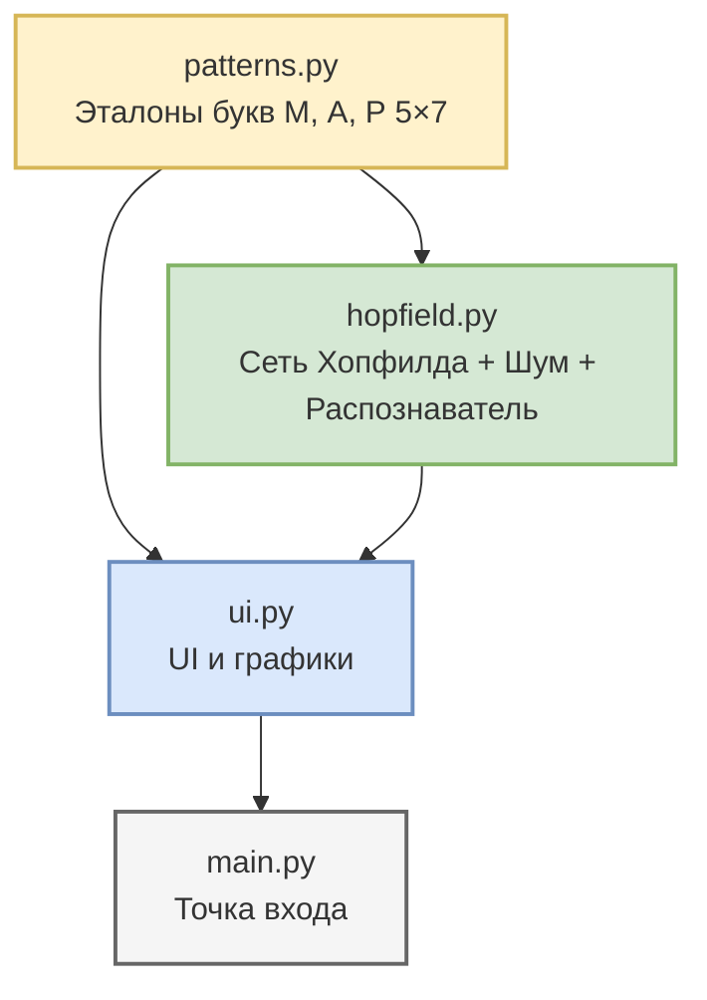

# Нейронная сеть Хопфилда для распознавания букв

Приложение на **Python 3** с графическим интерфейсом на **Tkinter** и графиками на **Matplotlib**. Программа реализует **нейронную сеть Хопфилда** как модель ассоциативной памяти, обучает ее на трех бинарных изображениях букв **М, А, Р** (первые буквы фамилии) размером 5×7 и исследует устойчивость распознавания к зашумлению.

---

## Архитектура и структура проекта

```text
hopfield-lab/
├── patterns.py                # Эталонные бинарные изображения букв М, А, Р (5×7)
├── hopfield.py                # Нейронная сеть Хопфилда, генератор шума, распознаватель
├── ui.py                      # Графический интерфейс 
├── main.py                    # Точка входа
├── requirements.txt           # Зависимости проекта
├── .gitignore                 # Исключения для Git
└── README.md                  # Документация проекта
```

### Диаграмма взаимодействия модулей



---

## Математическая постановка задачи

Каждый образ описывается **бинарной матрицей 5×7**, которая преобразуется в **биполярный вектор** длиной $N = 35$:

| Параметр | Описание | Значение |
| :---: | :--- | :---: |
| **N** | Число нейронов сети | 35 (5×7) |
| **$s_i$** | Состояние нейрона | $\{-1, +1\}$ |
| **W** | Матрица весов | 35×35, симметричная, диагональ = 0 |

### Математические этапы

1. **Обучение по правилу Хебба:**
   Веса связей вычисляются как усреднённое внешнее произведение запоминаемых образов:
   $$W_{ij} = \frac{1}{n} \sum_{k=1}^{n} x_i^{(k)} x_j^{(k)}, \quad W_{ii} = 0$$
   где $x^{(k)}$ — $k$-й образ в биполярном виде, $n$ — число образов.

2. **Асинхронное восстановление:**
   На каждой итерации случайно выбирается нейрон $i$, вычисляется локальное поле и обновляется состояние:
   $$h_i = \sum_{j} W_{ij} s_j$$
   $$s_i = \left\{ \begin{array}{ll} +1, & h_i > 0 \\ -1, & h_i < 0 \\ s_i, & h_i = 0 \end{array} \right.$$
   Процесс продолжается до стабилизации состояний.

3. **Функция энергии:**
   Динамика сети гарантированно сходится к локальному минимуму энергии:
   $$E = -\frac{1}{2} \sum_{i} \sum_{j} W_{ij} s_i s_j$$

4. **Зашумление:**
   Инвертируется ровно `percent%` случайно выбранных пикселей образа.
---

## Ключевые возможности приложения

* **Графики:** Одновременное отображение эталонного, зашумленного и восстановленного сетью образов в трех полях.
* **Распознавание:** Возможность выбрать букву (М, А или Р) и задать процент зашумления через форму ввода — сеть восстановит образ, а распознаватель определит, к какому эталону он ближе всего.
* **Журнал событий:** Автоматический вывод расстояния Хэмминга, результата распознавания и статуса (OK/FAIL) для каждого теста.
* **Статистика:** Кнопка «100 тестов для этого %» выполняет по 100 испытаниям на каждый класс при заданном уровне шума и выводит точность.
* **Полный анализ 10–100%:** Автоматическое тестирование при 12 уровнях зашумления (по 50 испытаний на класс) с построением сводной таблицы и графика.
* **Экспорт графика:** Сохранение графика точности в PNG, PDF или SVG.

---

## Установка и запуск

### Системные требования
* **Python 3.9** или выше
* Операционная система: Windows, macOS, Linux

### Инструкция по запуску

1. Склонируйте репозиторий с проектом:
   ```bash
   git clone 
   cd hopfield-lab
   ```

2. Создайте и активируйте изолированное виртуальное окружение:
   ```bash
   # Для Windows:
   python -m venv .venv
   .venv\Scripts\activate

   # Для Linux / macOS:
   python3 -m venv .venv
   source .venv/bin/activate
   ```

3. Установите обязательные внешние зависимости:
   ```bash
   pip install -r requirements.txt
   ```

4. Запустите приложение:
   ```bash
   python main.py
   ```

---

## Использование

После запуска программы:

1. Выберите букву в выпадающем списке (**М, А** или **Р**).
2. Укажите процент зашумления (от 0 до 100).
3. Нажмите одну из кнопок:
   - **«Подать зашумленный образ»** — одиночный тест с визуализацией;
   - **«100 тестов для этого %»** — статистика по 100 испытаниям на каждый класс;
   - **«Полный анализ 10–100%»** — построение сводной таблицы и графика точности;
   - **«Показать график»** — открыть график в отдельном окне;
   - **«Сохранить график»** — экспортировать график в файл.
